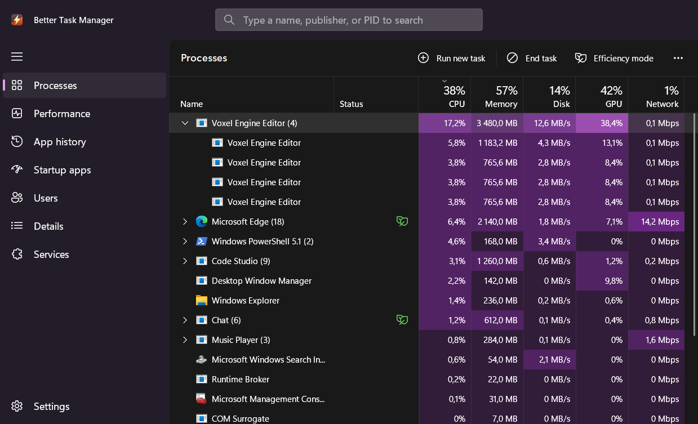
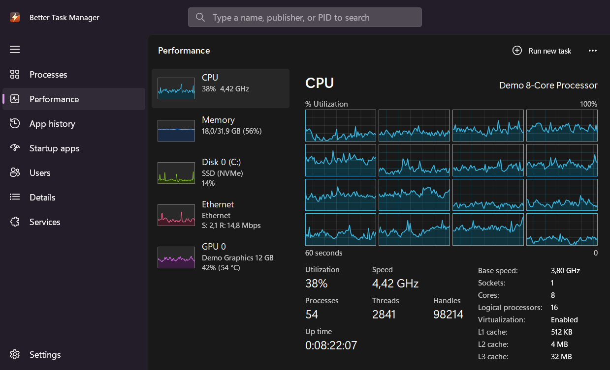
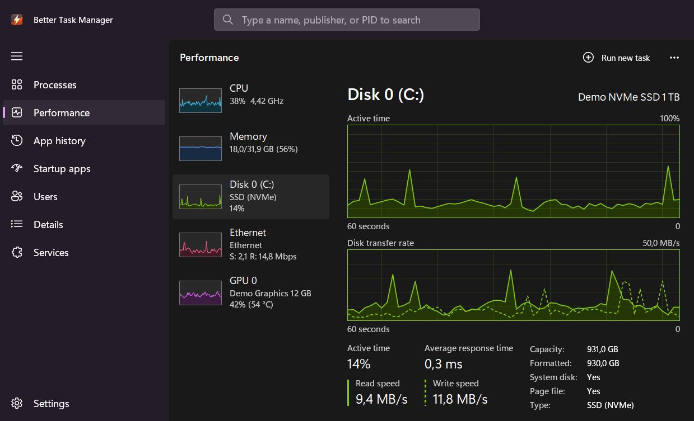
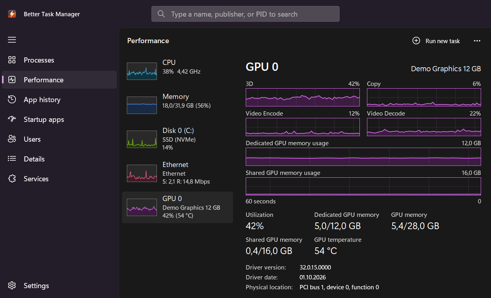
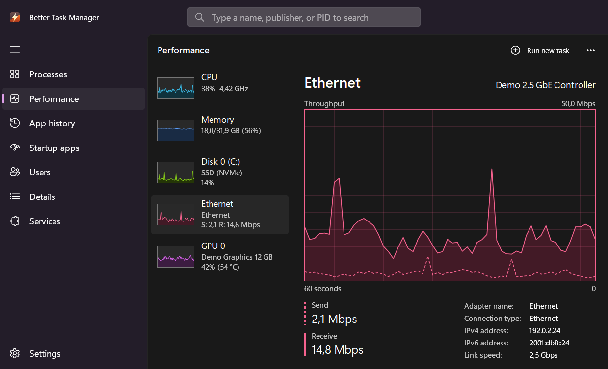
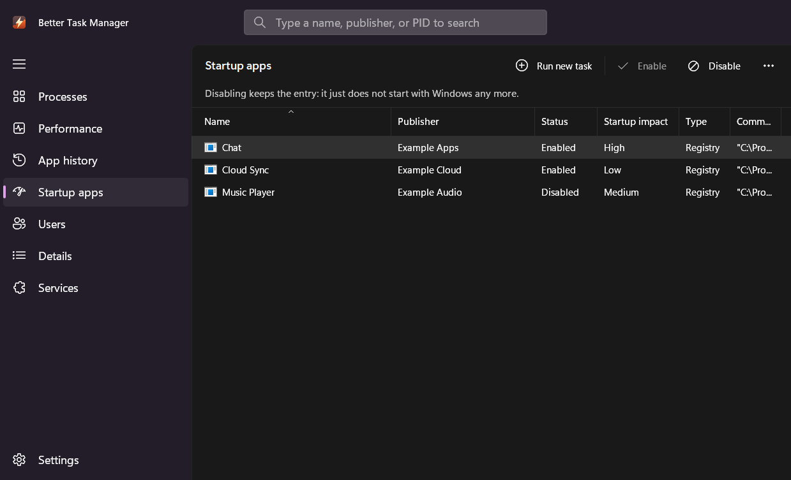
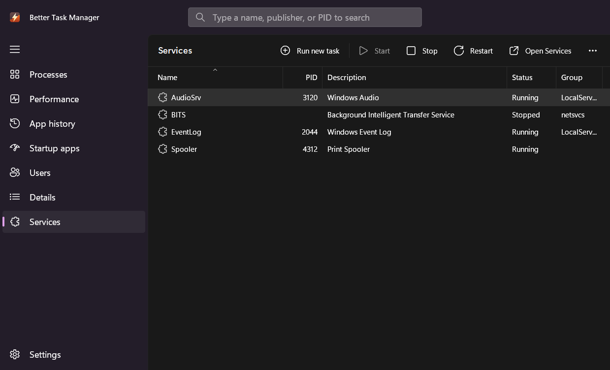

<p align="center">
  
</p>

<h1 align="center">Better Task Manager (BTM)</h1>

<p align="center">
  <b>The Task Manager Microsoft should have shipped.</b><br>
  Everything you open Task Manager for, in a native Rust app for Windows 11.
</p>

<p align="center">
  <a href="https://github.com/TabanAziz/BetterTaskManager/releases/latest"><b>Download</b></a> ·
  <a href="#setup">Setup</a> ·
  <a href="#why-because-the-real-one-is-embarrassing">Why</a> ·
  <a href="#build-from-source">Build</a>
</p>



## Why? Because the real one is embarrassing

Task Manager has one job: be there **instantly** when your PC is on fire.
It is the fire extinguisher of Windows. Microsoft wrapped it in XAML, put it behind
a loading pause and called it modern.

You press Ctrl+Shift+Esc because something is eating your machine, and then you
wait. For the tool that is supposed to tell you why you are waiting.

And when it finally shows up, this is the quality you get from one of the richest
companies on the planet:

- **It could not be closed.** After the October 2025 update KB5067036, clicking X
  [did not end Task Manager][immortal]. Every reopen left another copy running in
  the background, and Microsoft itself admitted those copies "can cause noticeable
  slowdowns in other applications". The program you open to hunt down resource hogs
  *became the resource hog*. It took until KB5068861 in November to fix it.
- **It could not count.** In October 2024, KB5044384 made Task Manager report
  [**zero** apps, zero background processes and zero Windows processes][zero] on
  Windows 11 24H2 with "Group by type" on. Listing processes is the entire product.
- **It hangs.** On the PC this project was written on, Task Manager froze badly
  enough for Windows to file it as an application hang (Event ID 1002,
  Taskmgr.exe 10.0.26100.9549). Who do you call when the thing that kills frozen
  programs is the frozen program?
- **It is bloated.** `Taskmgr.exe` alone is 5.7 MB. BTM 1.0 weighed 1.1 MB with every page included.

A multi-trillion-dollar company owns the kernel, the scheduler, every private API
and the source code, and still ships this. So here is one that respects your time.

<sub>To be fair about the one thing that is not Microsoft's UI team's fault: a completely
CPU-starved Windows can stall <i>any</i> task manager, BTM included.
<a href="https://devblogs.microsoft.com/oldnewthing/20261027-00/?p=112800">Raymond Chen explains why</a>.</sub>

## The numbers

| Better Task Manager 1.0 | |
| --- | --- |
| Start until the window accepts input | **64 ms** |
| Process list on screen | **about 80 ms** |
| CPU while running in the background | **18 ms per second** (0.12 % of a 16-thread CPU) |
| Working set | **32 MB** |
| Size of the program | **1.1 MB**, no runtime, no installer dependencies |

<sub>Measured on a Ryzen 7 5800X with Windows 11 and about 620 running processes.
Start-up is the median of 15 launches. Your numbers will differ.</sub>

## What you get

Every page of the Windows 11 Task Manager:

| Page | |
| --- | --- |
| **Processes** | Apps grouped with their child processes, icons, real names, efficiency mode, heat map for CPU, memory, disk, GPU and network |
| **Performance** | CPU (overall or per logical processor), memory, every disk, network adapter and GPU, with live graphs and all the details |
| **App history** | Download and upload per app over the last 30 days, plus CPU time of what is running |
| **Startup apps** | Registry, Startup folders and Store apps: enable, disable, startup impact |
| **Users** | Every session with its resource usage and processes, disconnect, sign off |
| **Details** | The flat process list with PID, user, CPU, private memory and more |
| **Services** | Every service with start, stop and restart |

Plus search on every list (Ctrl+F), sorting on every column, per-monitor DPI and
an optional Ctrl+Shift+Esc takeover.

Choose a theme in **Settings**. **System** follows Windows with your accent color
and Mica. **Light** and **Dark** let you choose a Windows appearance for BTM.
**Deep Space**, **Paper White**, **Candy Rush**, **Frost**, **Eclipse** and
**Cyber Grid** use the same palettes and title bar motifs as BetterExplorer.
BTM remembers the selection.

| | |
| --- | --- |
|  |  |
|  |  |
|  |  |

<sub>All screenshots show invented demo data.</sub>

## Setup

**Requirements:** Windows 11, x64.

### Installer

1. Download `BTM-Setup-x.y.z.exe` from the [latest release][release].
2. Run it and click **Install**. It installs for your user only and needs no administrator rights.
3. Start **Better Task Manager** from the Start menu.

Windows SmartScreen warns about the file because it is not code-signed (certificates
cost money). Compare the file with `SHA256SUMS.txt` from the release, then choose
*More info > Run anyway*:

```powershell
Get-FileHash .\BTM-Setup-1.1.2.exe
```

### Portable

Download `BTM-x.y.z-portable.zip`, unpack it anywhere, run `BTM.exe`.

### Make Ctrl+Shift+Esc open BTM

Open **Settings** in BTM and switch on **Ctrl+Shift+Esc opens BTM**. Windows asks for
permission once. Switch it off there to get the Windows Task Manager back.

### Fill the Disk column

Windows only tells administrators how much each process reads and writes. Click
**Set up** (in the hint above the process list or in Settings) and confirm once.
BTM then has a small read-only helper that runs only while BTM is open. The same
helper provides *Startup impact*.

### Uninstall

*Settings > Apps > Installed apps > Better Task Manager > Uninstall.* This also gives
Ctrl+Shift+Esc back to Windows and removes the helper. If you used the portable
version, switch both off in BTM's Settings before you delete it.

## Keys

| Key | Action |
| --- | --- |
| Ctrl+F | Search |
| Del | End task |
| F5 | Refresh now |
| Arrows, Page Up/Down, Home, End | Move in lists |
| Left / Right | Collapse / expand |
| Right click | Commands for a row, columns, graph mode |

End task does not ask first, just like Task Manager. Only critical Windows processes get a warning.

## Honest limits

- App history has no CPU history: Windows keeps that in a database only the system
  can read, so the CPU column covers running processes.
- Service and some device names come from Windows in your display language.
- Numbers and dates follow your regional format.
- Windows 10 and ARM64 are untested.
- Some values come from undocumented Windows interfaces and may need a fix after a
  Windows update.

## Privacy and security

- No telemetry, no update checks, no network connections. *Search online* opens your
  browser, and only when you click it.
- The window runs without administrator rights. Single actions that need them ask
  through UAC.
- Everything Windows may start elevated points to a copy in Program Files, which
  normal programs cannot replace. Details in [SECURITY.md](SECURITY.md).

## Build from source

You need [Rust](https://rustup.rs/) 1.87 or newer with the MSVC toolchain and the
Windows SDK.

```powershell
git clone https://github.com/TabanAziz/BetterTaskManager
cd BetterTaskManager
cargo build --release              # target\release\BTM.exe
powershell -ExecutionPolicy Bypass -File tools\check.ps1     # format, lints, tests
powershell -ExecutionPolicy Bypass -File tools\release.ps1   # setup, zip and checksums in dist\
```

Contributions are welcome, see [CONTRIBUTING.md](CONTRIBUTING.md).

## License

[MIT](LICENSE). Notices for third-party work are in
[THIRD-PARTY-LICENSES](THIRD-PARTY-LICENSES).

<sub>Not affiliated with or endorsed by Microsoft. Windows is a trademark of Microsoft.
The opinions about their Task Manager are very much our own.</sub>

[release]: https://github.com/TabanAziz/BetterTaskManager/releases/latest
[immortal]: https://www.bleepingcomputer.com/news/microsoft/microsoft-fixes-windows-task-manager-bug-affecting-performance/
[zero]: https://www.bleepingcomputer.com/news/microsoft/windows-11-task-manager-bug-shows-wrong-number-of-running-processes/
